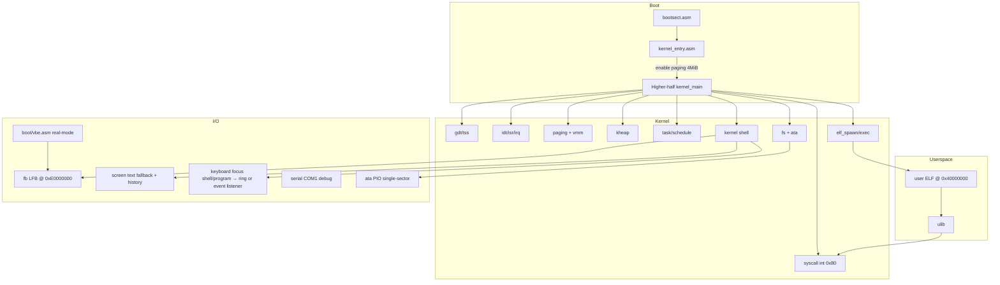

# chaOS — Agent knowledge map

Compact world-model. Prefer this over scanning the repo.

## Vision (product)

- Personal **x86 cyberdeck OS** (from-scratch Path A), installed on an **x86 board** (not Pi/ARM).
- Chaotic GUI: windows intentionally misaligned / disoriented; not a clone of Windows/GNOME.
- **Personal command language** (user-defined verbs), not generic Unix clones as the primary UX.
- Daily apps + IDE-ish workflow; languages via **host-side translators / cross-toolchain** shipping artifacts into chaOS.
- Aesthetic + identity matter (boot art, error voice, command names).

## Current technical state (Phase 11 done)

- 32-bit x86, higher-half kernel at `0xC0010000`. Identity map is installed RAM up to 1 GiB. The higher-half alias stays 16 MiB.
- Boot: floppy image (`chaos.flp` / `os-image.bin`), QEMU primary test bed. Interactive boot starts the desk (`chaoswm`) when a 32 bpp LFB is up; `q` returns to the kernel shell.
- Paging + per-process AS, ELF32 loader, ring-3, syscalls, preemptive tasks.
- Simple FS on ATA; **VBE** soft console + text caret; PS/2 keyboard + mouse.
- Personal lexicon in `terminal.elf` (`user/verbs.h`, `docs/agent/LEXICON.md`). The shell accepts only those verbs.
- Chaos compositor (`chaoswm.elf`); onboard editor (`scribe.elf`); host SDK notes.
- Pipes (IPC) between processes; user programs: `user/*.elf`, `terminal.elf`, ulib syscalls.
- Toolchain: `i386-elf-gcc` / `i386-elf-ld` via Makefile `CROSS`.

## Architecture graph

## Directory → responsibility

| Path | Own |
|------|-----|
| `boot/` | Bootsect, PM switch, VBE, higher-half stub, `kernel.ld` |
| `cpu/` | Arch layer: `arch.h` facade + x86 impl (GDT/IDT/paging/vmm/…) |
| `drivers/` | screen, **fb**, keyboard, serial, ata, mouse, pci |
| `kernel/` | main, shell, heap, fs (ATA or RAM backend), **initrd** (seeds fs from the boot image), task (+ surfaces, event queue), syscall, elf, pipe; shared user headers `fb_user.h`, `event_user.h`, `font8x8.h` |
| `libc/` | freestanding helpers |
| `user/` | crt0, ulib, **ugfx** (surface drawing), **utext** (text-grid widget), **attune.h** (shared deck mode file), sample ELFs, `linker.ld` @ `USER_BASE` |
| `tools/` | host `mkfs` (disk.img) and `mkinitrd` (initrd.bin); optional SDK notes under `tools/sdk/` |
| `docs/agent/` | MAP / ROADMAP / STATUS / LEXICON / ABI |

## Arch API (`cpu/arch.h`)

Kernel code includes `cpu/arch.h` (or a listed public header). Drivers may
include `ports.h` / `paging.h` / `vmm.h` directly for I/O and LFB mapping.
**Do not** include `idt.h` / `type.h` outside `cpu/`.

| Header | Contract (port keeps these names) |
|--------|-----------------------------------|
| `memlayout.h` | `KERNEL_VIRT_BASE`, `PHYS_TO_VIRT` / `VIRT_TO_PHYS`, `HIGH_PDE_INDEX` |
| `paging.h` | `init_paging`, `PAGE_*`, `kernel_directory`, `load_page_directory` |
| `vmm.h` | `frame_*`, `vmm_create/destroy_addrspace`, `vmm_map`, `USER_BASE` layout |
| `isr.h` | `isr_install` / `irq_install`, `register_interrupt_handler`, `registers_t`, `IRQ*` |
| `gdt.h` | `init_gdt`, `tss_set_stack`, `KERNEL_*_SEL` / `USER_*_SEL` |
| `timer.h` | `init_timer(freq)`, `timer_ticks()` |
| `power.h` | `power_off`, `qemu_debug_exit` |
| `ports.h` | PIO byte/word/dword in/out |
| `context.h` | `context_switch`, `enter_user_mode` |

x86-only today: PIO ports, IDT gate layout, `int 0x80` syscall vector, TSS
privilege stacks. A later arch would reimplement these headers; task/elf/fs
stay. ARM is **not** on the roadmap unless STATUS changes.

Syscall numbers / structs for userspace: [`ABI.md`](ABI.md).

## Critical constants

| Symbol / value | Meaning |
|----------------|---------|
| `KERNEL_VIRT_BASE` `0xC0000000` | Higher half |
| Load phys `0x10000` | Boot stub + kernel LMA; `KERNEL_LOAD_SECTORS` 256 (128 KiB budget, Makefile asserts) |
| `INITRD_PHYS` `0x34000` | Initrd blob ("CHAOSIRD", all user ELFs) loaded by bootsect; `INITRD_MAX` `0x58000` bytes (ends below the `0x90000` boot stack) |
| `USER_BASE` `0x40000000` | User link address |
| `SURF_BASE` `0x50000000` | Per-task pixel surfaces, 4 × 4 MiB PDE slots (G2) |
| `HIGH_PDE_INDEX` 768 | Higher-half PDE slot |
| Identity map | Installed RAM, capped at 1 GiB. Higher-half alias is 16 MiB so it does not cover the framebuffer. |

## Invariants (do not break)

1. Boot stub stays VMA==LMA at `0x10000`; rest linked high via `boot/kernel.ld`. Boot image layout is fixed: sector 0 bootsect, sectors 1..256 kernel (`KERNEL_SECTORS` in Makefile == `KERNEL_LOAD_SECTORS`), then `initrd.bin` at `INITRD_PHYS`. `.bss` is **not** loaded from disk — `kernel_entry.asm` zeroes `__bss_start..__bss_end` (keep those symbols in `kernel.ld`). The image must work with **no disk attached**: `fs_mount` falls back to a RAM backend and `initrd_install()` seeds programs, so never make a boot path depend on `disk.img`.
2. Every page directory shares kernel PDEs **and** higher-half aliases; destroy must skip both.
3. Shell commands must not block inside IRQ — queue + `shell_poll` with IF=1.
4. ATA: **single-sector** PIO only (VirtualBox).
5. `TASK_DEAD` must be reaped; `task_count` ignores DEAD.
6. Failed `exec` must `fs_exists` early; no zombie confusion.
7. AUTOTEST: `make test` → isa-debug-exit; keep tests green when touching task/elf/fs/input/fb.
8. LFB PDEs at `0xE0000000` are shared like kernel maps; `vmm_destroy_addrspace` must not free them.
9. Boot VBE calls need **ES=0** (after `load_kernel`, ES is not 0).
10. Every syscall that dereferences a caller pointer validates it with `user_range_ok` / `user_str_ok` (`kernel/uaccess.h`) first. New syscalls must too; `badptr.elf` AUTOTEST probes them.
11. Surfaces occupy one whole PDE each (`vmm_unmap_pde`); `task_t.surf[]` is the source of truth for which surface addresses are valid. Never map anything else into `[SURF_BASE, SURF_END)`.
12. `TASK_BLOCKED` is entered only by `task_event_wait` (cli → check queue → block → `schedule`). Producers (`task_event_key` / `task_event_mouse`, IRQ context) only enqueue and flip the listener to `READY`; they never call `schedule`. One **active** listener at a time (`ev_listener`); a previous listener is stacked (depth 4) and restored when the current task exits. `TASK_FROZEN` is a separate state: the scheduler skips it, and an event push does not thaw it.
13. Console syscalls (`PRINT`, `GETCHAR`, `READLINE`, `TRYCHAR`) go through `con_print` / `sys_getchar` in `syscall.c`, which honour `task_t.stdin_pipe` / `stdout_pipe`. Never call `kprint` / `kbd_getchar` directly from a syscall that a windowed client might use. Only the `io_owner` closes stdout at exit (inherited children must not).

## Syscall surface (ulib)

Full table in [`ABI.md`](ABI.md) (v9). Extend deliberately; bump ABI version + STATUS.

## Input routing (G3) and windowed clients (G4)

- Kernel shell has focus → keys edit the shell line, clicks place its caret.
- Program has focus, no listener → keys go to the `SYS_GETCHAR` ring (`terminal`, `scribe`, `folio` run bare).
- A task called `SYS_EVENT_WAIT` → it is the listener: program-focus keys and **all** mouse packets become `uevent_t`s in its queue (`kernel/event_user.h`); it sleeps `TASK_BLOCKED` between them. `chaoswm`, `mousedemo` use this.
- `chaoswm` as compositor server: per window two pipes + `SYS_SPAWNIO`; client output → `utext_t` grid (`user/utext.c`) → composed into the back buffer with the window's skew; keys for the focused window → its stdin pipe (Esc toggles command mode). Client exit = EOF on its stdout; banish = close its stdin (kernel ends the client on its next read). Clients never call `SYS_FB`.
- `t` or the **terminal** desk icon summons `terminal.elf` at 2× on every attune mode. Icons are the `desk_icons` table in `user/chaoswm.c` (label, program, glyph, scale). PgUp/PgDn scroll the focused window's `utext` history (48 lines). At the prompt, Up/Down scroll that history and Left/Right/Home/End move the caret. In app mode those four arrows are delivered to the client, so `scribe` can move. `2` toggles glyph scale.
- **q and F1 do not leave the desk.** The kernel shell is not reachable from the GUI. `kbd_console_override` still exists and still swallows user `SYS_FB` draws, but no key sets it.
- **G6 desk:** interactive boot execs `chaoswm` when `fb_available()` and stays there. Palette follows the `attune` file (`user/attune.h`). Modes: deck (blue), notes (warm), code (phosphor). `a` cycles; chips are clickable. Programs sit on the desk as icons; the toolbar is modes only. The desk itself added no syscall. Process control is ABI v8 (`SYS_PROCS`, `SYS_PSCTL`, `SYS_POWER`). The wall clock is ABI v9 (`SYS_CLOCK`).
- **Directories** stay inside the existing 24-byte file name. A directory is a zero-byte file ending in `/`. A file in it is a path such as `notes/hello`. The current directory lives in `terminal.elf` only. `summon` still uses the stored program name. ABI stays v7.

## Framebuffer drawing rules (G1)

- `fb_fill_rect` / `fb_blit` / `fb_draw_string` / `fb_clear` clip to the
  screen and lift/re-stamp the XOR mouse cursor themselves (`paint_begin` /
  `paint_end` in `drivers/fb.c`, IRQs held only while the cursor is lifted).
  Do **not** sprinkle `mouse_fb_cleared()` / `mouse_cursor_hide()` around
  new drawing code.
- `fb_put_pixel` is the raw path (no cursor handling) — the cursor itself
  uses it. Prefer rect primitives for anything bigger than a pixel.

## Corner-cut language strategy (future)

- Build on the **host**. `make sdk SRC=file.c` (`tools/sdk/chaos-sdk`) cross-builds one ELF and writes it to `disk.img`.
- Deck runs artifacts only until a tiny VM is an explicit roadmap step.
- No OpenJDK/CPython-in-kernel goals.

## Hardware target

- **x86 board** for cyberdeck (aligns with current arch). Published floor: 1 GHz, legacy BIOS, 1 GB RAM, about 1 GB disk (`BRINGUP.md`).
- **Firmware freeze (P3.1):** legacy **BIOS only** — no UEFI bootloader.
- Bring-up checklist: [`BRINGUP.md`](BRINGUP.md).
- **G7 display freeze:** 800×600×32 (VBE 0x115 + LFB). See `BRINGUP.md` § G7.

## Where NOT to look first

- Do not re-read all of `kernel.c` / `task.c` for product vision — use ROADMAP/STATUS.
- Do not revive ARM/Pi plans unless user changes STATUS hardware line.
